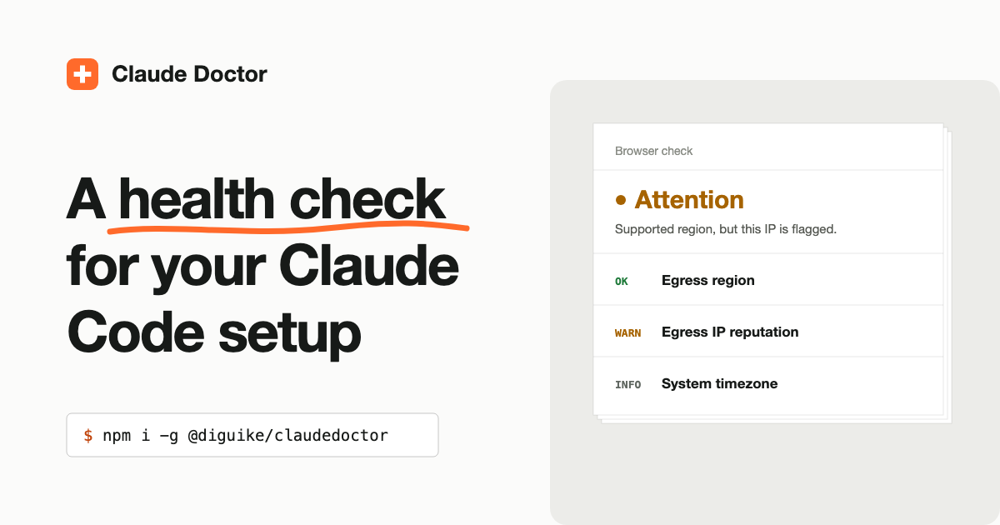

<div align="center">

<picture>
  <source srcset="https://raw.githubusercontent.com/diguike/claudedoctor/main/packages/web/public/og.svg" type="image/svg+xml" />
  
</picture>

# Claude Doctor

A health check for your Claude Code setup. It finds what is wrong, fixes what it safely can, and checks again.

[](https://github.com/diguike/claudedoctor/actions/workflows/ci.yml)
[](https://www.npmjs.com/package/@diguike/claudedoctor)
[](https://nodejs.org)
[](LICENSE)

[Website](https://claudedoctor.pages.dev) · [中文](#中文)

</div>

## Install

```bash
npm install --global @diguike/claudedoctor
```

Needs Node.js 20 or newer. The command is `claudedoctor`; `cdoc` is the same thing, shorter.

## Use

```bash
claudedoctor                # check this machine; nothing leaves it
claudedoctor check --net    # also look up where your terminal exits
claudedoctor check --why    # show the reasoning behind each line
claudedoctor fix            # pick fixes and apply them
claudedoctor verify         # check again after fixing
claudedoctor reset          # preview a cache reset; add --apply to do it
claudedoctor env --json     # print what the tool sees, with secrets removed
```

A typical run is `check`, then `fix`, then `verify` in a new terminal.

## What it looks at

- **Which credential is in use.** Claude Code can pick up an API key, a gateway token, a helper script, or your subscription login. An old `ANTHROPIC_API_KEY` in your shell often overrides the login you meant to use.
- **Relays.** Whether your subscription login is being sent to an address that is not Anthropic's.
- **Which `claude` you are running.** Native installer, Homebrew, WinGet, or npm. This is a path check, not a signature check.
- **Where your traffic exits** (`--net`). The region, and whether it is on Anthropic's supported list. IPv4 and IPv6 are checked separately, and so is the path Node itself uses, because a system proxy often covers the browser and not the terminal.
- **Proxy setup.** Proxy environment variables, system proxy and TUN state, and common Clash / Mihomo configurations.

Each line in the report says how sure it is: `confirmed`, `reported`, or `speculative`.

Without a key, `--net` reports region and network operator only. To also see VPN, proxy, and datacenter flags, set `IPDATA_API_KEY` to your own [ipdata.co](https://ipdata.co/) key.

## Fixing

`fix` only writes one marked block in your shell profile. It backs the file up first, and `claudedoctor fix --revert` removes the block.

```bash
claudedoctor fix --dry-run   # show what would change
claudedoctor fix --all       # apply everything that can be applied safely
claudedoctor fix --session   # print the commands instead of writing a file
```

Problems it cannot change for you, such as your network, are listed with the steps to do by hand.

## Resetting local caches

Useful after switching accounts. `claudedoctor reset` lists the caches it would move; `claudedoctor reset --apply` moves them into `~/.claudedoctor-cleanup-backups/`. Nothing is deleted. Quit Claude Code and Claude Desktop first.

It leaves your login, settings, skills, plugins, hooks, conversations, and projects alone.

If you only want the script:

```bash
curl -fsSL https://raw.githubusercontent.com/diguike/claudedoctor/main/scripts/reset-claude-cache.sh -o reset-claude-cache.sh
bash reset-claude-cache.sh           # preview
bash reset-claude-cache.sh --apply   # move to backup
```

## Clash setup skill

[`skills/claude-isp-clash`](./skills/claude-isp-clash/SKILL.md) is a skill for Claude Code and similar agents. It builds a Clash Verge profile that sends Claude's traffic through your own static ISP node, leaves other traffic on its usual route, and then checks that the routing works.

```bash
mkdir -p ~/.claude/skills/claude-isp-clash
curl -fsSL https://raw.githubusercontent.com/diguike/claudedoctor/main/skills/claude-isp-clash/SKILL.md \
  -o ~/.claude/skills/claude-isp-clash/SKILL.md
```

## Privacy

- Everything runs locally unless you pass `--net`.
- `--net` sends your public IP to ipapi.is and ipdata. Nothing else is sent.
- Credentials are only classified by type. Their values are never printed or logged.
- The website checks the browser you open it in. It cannot see your terminal, your credentials, or your Claude configuration.

## Exit codes

| Code | Meaning |
|---:|---|
| `0` | Nothing found |
| `1` | Something needs attention, or a requested check could not finish |
| `2` | A confirmed policy risk |
| `64` | Bad command or option |

`--json` gives the same result in a versioned format for scripts.

## Platforms

| Platform | What works |
|---|---|
| macOS | Everything |
| Linux / WSL | Everything; proxy detection covers fewer clients |
| Windows | Checks work; `fix` needs Git Bash or WSL |

## Limits

A clean report means none of the known problems were found. It does not predict what happens to an account, and it does not describe how Anthropic enforces its policies. Notes on what has and has not been verified are in [`docs/`](./docs).

Claude Doctor is not affiliated with Anthropic.

## Development

```bash
corepack enable
pnpm install --frozen-lockfile
pnpm validate     # typecheck, tests, web build, package audit
pnpm dev:web      # http://localhost:4321
```

`packages/core` holds the diagnosis logic, `packages/cli` the command, `packages/web` the site. See [CONTRIBUTING.md](CONTRIBUTING.md) and [SECURITY.md](SECURITY.md).

## 中文

Claude Doctor 给本机的 Claude Code 做体检：查出问题，能自动改的帮你改，改完再查一遍。

```bash
npm install --global @diguike/claudedoctor

claudedoctor                # 体检本机，不联网
claudedoctor check --net    # 加查终端的出口地区
claudedoctor fix            # 选择并应用修复
claudedoctor verify         # 改完复查
claudedoctor reset          # 预览清缓存，加 --apply 才执行
```

它会看这几样：

- **实际生效的凭证。** 环境里残留的 `ANTHROPIC_API_KEY` 经常盖过订阅登录。
- **中转。** 订阅登录有没有被发到非官方地址。
- **客户端来源。** 你运行的 `claude` 是从哪里装的。
- **出口**（`--net`）。地区是否受支持；IPv4、IPv6 和 Node 自己走的路径分开查。
- **代理设置。** 代理环境变量、系统代理、TUN，以及常见的 Clash / Mihomo 配置。

免 key 的情况下，`--net` 只能查到出口地区和运营方。想看 VPN、代理、机房标记，把 `IPDATA_API_KEY` 设成你自己的 [ipdata.co](https://ipdata.co/) key。

换账号之后可以用 `claudedoctor reset` 清掉本机的旧缓存。文件是移到 `~/.claudedoctor-cleanup-backups/`，不会删除；登录状态、配置、skills 和会话记录都不动。只想要脚本的话，直接用 [`scripts/reset-claude-cache.sh`](./scripts/reset-claude-cache.sh)。

买了静态 ISP 代理之后怎么配 Clash，见 [`skills/claude-isp-clash`](./skills/claude-isp-clash/SKILL.md)，装进 Claude Code 后让它按你的节点生成配置。

网页版在 [claudedoctor.pages.dev](https://claudedoctor.pages.dev)，打开就会检查当前浏览器的出口。它看不到你的终端和本地配置。

体检通过只表示没有发现已知问题，不代表账号一定不会受限。本项目与 Anthropic 无关。

## License

MIT © [递归客](https://diguike.dev/)
